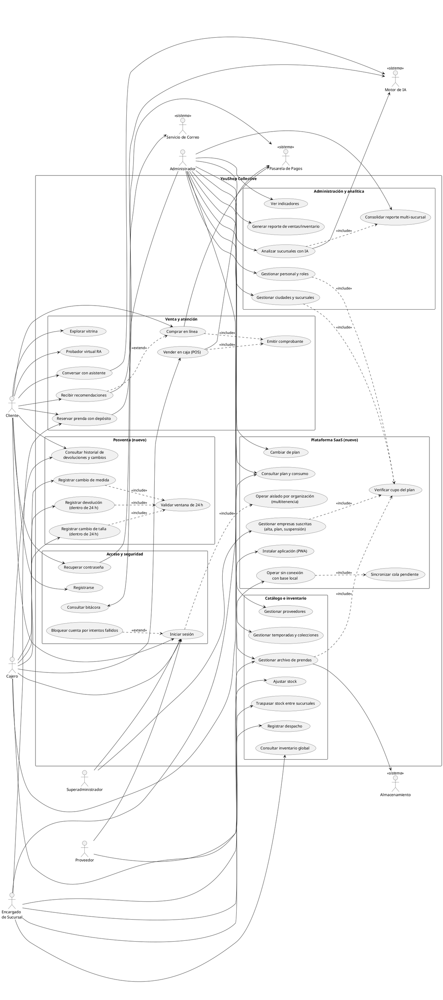

# 1. Modelo de casos de uso

Primer paso de ICONIX. Los actores salen de los roles reales que existen en la
base (`rol`: Administrador, Encargado de Sucursal, Cajero, Proveedor, Cliente)
y los casos de uso de los endpoints efectivamente implementados.

## Actores

| Actor | Origen en el sistema | Alcance |
|-------|----------------------|---------|
| **Cliente** | `rol.codigoRol = 5` | Vitrina, reservas, compra online, su propio historial |
| **Cajero** | `rol.codigoRol = 3` | Caja presencial, devoluciones y cambios |
| **Encargado de Sucursal** | `rol.codigoRol = 2` | Inventario, despachos, reservas de su sucursal |
| **Administrador** | `rol.codigoRol = 1` | Todo lo anterior + personal, planes y reportes |
| **Proveedor** | `rol.codigoRol = 4` | Catálogo asociado a sus productos |
| **Superadministrador** | rol `Superadministrador` (migración 016) | Opera la plataforma SaaS: todas las empresas suscritas |
| *Pasarela de Pagos* (Stripe) | Sistema externo | Cobros con tarjeta |
| *Motor de IA* (Gemini) | Sistema externo | Recomendaciones, chat y análisis multi-sucursal |
| *Almacenamiento* (Supabase) | Sistema externo | Imágenes de producto |
| *Correo* (Brevo) | Sistema externo | Recuperación de contraseña |

## Diagrama general

<!-- Modelo completo: casos de uso existentes + CU26..CU30 nuevos -->

## Guía para explicar el diagrama general

Cada caso representa un objetivo observable del actor; los paquetes agrupan
responsabilidades para que el diagrama se pueda recorrer por módulos. Estas
notas sirven para explicar qué aporta cada objetivo durante la defensa:

| Módulo | Caso de uso | Comentario para defenderlo |
|---|---|---|
| Acceso y seguridad | Registrarse | Crea una identidad con los datos mínimos y el rol que habilita su recorrido inicial. |
| Acceso y seguridad | Iniciar sesión | Verifica credenciales y establece la identidad y el contexto que usarán las solicitudes protegidas. |
| Acceso y seguridad | Recuperar contraseña | Permite recuperar acceso mediante el servicio de correo sin revelar si una cuenta existe. |
| Acceso y seguridad | Bloquear cuenta por intentos fallidos | Limita intentos repetidos para reducir ataques de adivinación de contraseñas. |
| Acceso y seguridad | Consultar bitácora | Da al administrador trazabilidad de acciones relevantes para auditoría y diagnóstico. |
| Catálogo e inventario | Gestionar archivo de prendas | Mantiene la información del producto que consultan el catálogo, las ventas y el inventario. |
| Catálogo e inventario | Gestionar proveedores | Relaciona los productos con sus proveedores para apoyar el abastecimiento. |
| Catálogo e inventario | Gestionar temporadas y colecciones | Organiza prendas por temporada y colección para su administración y exhibición. |
| Catálogo e inventario | Consultar inventario global | Permite revisar existencias considerando las sucursales disponibles. |
| Catálogo e inventario | Ajustar stock | Registra una corrección explícita de existencias, en vez de alterar el saldo sin trazabilidad. |
| Catálogo e inventario | Traspasar stock entre sucursales | Mueve unidades entre ubicaciones y conserva la relación entre la salida y el ingreso. |
| Catálogo e inventario | Registrar despacho | Registra el envío de productos y permite seguir su atención logística. |
| Venta y atención | Explorar vitrina | Da al cliente acceso al catálogo disponible antes de reservar o comprar. |
| Venta y atención | Reservar prenda con depósito | Aparta una prenda durante un período definido y registra el depósito asociado. |
| Venta y atención | Comprar en línea | Completa la compra remota validando el pago y la disponibilidad desde el servidor. |
| Venta y atención | Vender en caja (POS) | Permite al cajero registrar una venta presencial con sucursal, cliente e ítems. |
| Venta y atención | Emitir comprobante | Presenta el resultado confirmado de la venta para consulta o impresión. |
| Venta y atención | Probador virtual RA | Ayuda al cliente a visualizar prendas como apoyo a la decisión de compra. |
| Venta y atención | Conversar con asistente | Ofrece orientación conversacional usando el motor externo de IA. |
| Venta y atención | Recibir recomendaciones | Sugiere productos como complemento del recorrido de compra, sin sustituir la decisión del cliente. |
| Posventa | Registrar cambio de talla | Atiende un cambio dentro de la ventana permitida y corrige inventario en la misma operación. |
| Posventa | Registrar cambio de medida | Registra el ajuste de medida de la prenda sin tratarlo como una venta nueva. |
| Posventa | Registrar devolución | Procesa la devolución bajo la regla temporal y deja evidencia del ajuste realizado. |
| Posventa | Consultar historial de devoluciones y cambios | Permite verificar operaciones anteriores por cliente o fecha y sostener la atención posventa. |
| Posventa | Validar ventana de 24 h | Centraliza una regla de negocio que deben cumplir los cambios y devoluciones sujetos a plazo. |
| Administración y analítica | Gestionar personal y roles | Administra usuarios internos y sus permisos de acuerdo con sus responsabilidades. |
| Administración y analítica | Gestionar ciudades y sucursales | Mantiene las ubicaciones que sirven de contexto a inventario, ventas y reportes. |
| Administración y analítica | Ver indicadores | Resume datos operativos para apoyar el seguimiento del negocio. |
| Administración y analítica | Generar reporte de ventas/inventario | Produce información consultable sobre ventas y existencias para análisis operativo. |
| Administración y analítica | Consolidar reporte multi-sucursal | Agrupa métricas por sucursal para comparar resultados dentro de la organización. |
| Administración y analítica | Analizar sucursales con IA | Añade una lectura asistida sobre métricas calculadas; la IA no reemplaza los datos fuente. |
| Plataforma SaaS | Operar aislado por organización | Asegura que cada empresa trabaje con su propio conjunto de datos dentro de la plataforma compartida. |
| Plataforma SaaS | Consultar plan y consumo | Hace visibles los límites y el uso actual antes de que el administrador gestione su suscripción. |
| Plataforma SaaS | Cambiar de plan | Actualiza la suscripción después de comprobar que el consumo cabe en los límites de destino. |
| Plataforma SaaS | Verificar cupo del plan | Impide altas que superen los límites contratados antes de persistir el nuevo recurso. |
| Plataforma SaaS | Instalar aplicación (PWA) | Permite usar la aplicación desde el dispositivo y preparar su shell para conectividad variable. |
| Plataforma SaaS | Operar sin conexión con base local | Mantiene disponible el flujo de caja en efectivo cuando no hay red. |
| Plataforma SaaS | Sincronizar cola pendiente | Reenvía operaciones locales al recuperar la conexión y conserva las que requieren revisión. |
| Plataforma SaaS | Gestionar empresas suscritas | Reserva la administración transversal de organizaciones al rol de Superadministrador. |

Las relaciones `<<include>>` señalan una tarea obligatoria o compartida, como
validar el cupo antes de un alta; `<<extend>>` representa una condición
adicional, como bloquear el acceso tras intentos fallidos. Stripe, Gemini,
Supabase y Brevo aparecen como actores externos porque colaboran con el
sistema, pero no forman parte de su lógica interna.

## Casos de uso nuevos — descripción

### CU26 — Operar aislado por organización (multitenencia)

- **Actor principal:** todos los roles (transversal).
- **Precondición:** el usuario pertenece a un tenant activo.
- **Flujo básico:** al iniciar sesión, el backend incorpora el claim `tenant`
  al JWT; toda consulta de catálogo, sucursales, proveedores, temporadas,
  colecciones y personal filtra por ese tenant.
- **Postcondición:** el usuario solo ve y modifica datos de su organización.
- **Excepción:** un recurso de otro tenant responde **404** (no 403): que
  exista no es información que deba cruzar la frontera de la organización.

**Comentario para defensa:** la frontera importante aquí es la organización.
El tenant se toma de la identidad autenticada y se aplica en las consultas;
así no se confía en que el cliente web envíe un identificador de empresa válido.

### CU27 — Consultar plan y cambiar de plan

- **Actor principal:** Administrador (cambio); Encargado y Cajero (consulta).
- **Flujo básico:** se muestran plan vigente, límites y consumo
  (`GET /api/tenant/me`); el administrador puede cambiar de plan
  (`PATCH /api/tenant/plan`).
- **Excepción:** si el consumo actual supera los topes del plan destino, el
  cambio se rechaza con **409** detallando qué recurso lo excede.
- **Regla asociada (CU-CUPO):** crear sucursal, usuario o producto verifica el
  cupo antes de insertar y responde **402** cuando se alcanzó el tope.

**Comentario para defensa:** consultar y cambiar de plan son acciones
distintas: la consulta es transversal para la operación y el cambio requiere
permiso administrativo y validar el consumo contra los límites destino.

### CU28 — Devolución y cambio de talla / medida dentro de 24 h

- **Actor principal:** Cajero (también Encargado y Administrador).
- **Precondición:** existe una venta de ese producto con menos de 24 h.
- **Flujo básico:** se elige un item elegible, se indica el tipo (cambio de
  talla, cambio de medida o devolución), la cantidad y el motivo; el sistema
  reingresa la prenda original al inventario y, si es cambio de talla,
  descuenta la prenda de la talla nueva en la misma transacción.
- **Postcondición:** queda registrado quién, cuándo, qué talla salió y cuál
  entró (consultable por fecha y cliente).
- **Excepciones:** ventana vencida → **409**; cantidad mayor a la disponible
  → **400**; sin stock de la talla nueva → **409** (no se registra nada).

**Comentario para defensa:** el servidor vuelve a validar el plazo, la
cantidad y el stock para evitar depender de datos viejos de la pantalla. La
transacción evita dejar registrada solo la mitad de un cambio.

### CU29 — Consolidado multi-sucursal y análisis con IA

- **Actor principal:** Administrador.
- **Flujo básico:** se calcula por SQL el consolidado por sucursal (unidades,
  monto, stock, SKUs críticos); opcionalmente se envía ese consolidado al
  motor de IA, que devuelve diagnóstico por sucursal, transferencias
  sugeridas y alertas.
- **Regla:** la IA solo interpreta métricas ya calculadas; nunca produce
  cifras propias, y las sucursales que no estaban en los datos se descartan.
- **Excepciones:** plan sin IA → **402**; motor no configurado → **503**.

**Comentario para defensa:** primero se calculan métricas confiables con SQL;
la IA interpreta ese insumo y sus sugerencias se contrastan con las sucursales
analizadas antes de mostrarlas.

### CU31 — Gestionar empresas suscritas (consola de plataforma)

- **Actor principal:** Superadministrador.
- **Precondición:** el usuario tiene el permiso `plataforma.admin`, que solo
  recibe el rol Superadministrador (ningún Administrador de empresa lo tiene).
- **Flujo básico:** ve todas las empresas con su plan, consumo de cupos,
  administrador y estado, más el ingreso mensual de la plataforma; puede dar
  de alta una empresa con su administrador inicial, cambiarle el plan o
  suspenderla (`/api/platform/*`).
- **Flujos adicionales:** cambiar el nombre visible de una empresa (el
  identificador no cambia); consultar la **bitácora de todas las empresas**
  con paginación y filtros por empresa, texto y fechas; generar, descargar y
  eliminar **respaldos por empresa** (manuales desde la consola, automáticos
  diarios disparados por GitHub Actions, con retención configurable).
- **Postcondición:** una empresa suspendida no puede iniciar sesión hasta que
  se la reactive.
- **Excepciones:** bajar de plan cuando el consumo supera los nuevos topes →
  **409**; suspender la empresa operadora → **409**; un rol sin
  `plataforma.admin` → **403**.

**Comentario para defensa:** esta consola cruza la frontera entre empresas,
por eso exige un permiso exclusivo de plataforma y conserva protecciones para
evitar suspender accidentalmente a la organización que opera el servicio.

### CU30 — PWA, operación sin conexión y sincronización

- **Actor principal:** Cajero.
- **Flujo básico:** la aplicación se instala en el dispositivo; el catálogo,
  las sucursales y el inventario se replican en la base local (IndexedDB);
  sin conexión, una venta en efectivo se guarda en la cola local y, al volver
  la red, se reenvía automáticamente.
- **Postcondición:** ninguna operación se pierde por falta de conectividad.
- **Excepción:** una operación rechazada definitivamente por el servidor
  queda marcada con el error en la cola, sin reintentos en bucle.

**Comentario para defensa:** IndexedDB conserva las operaciones hasta recibir
confirmación del servidor. Los reintentos respetan el orden y separan errores
transitorios de rechazos que necesitan corrección manual.
