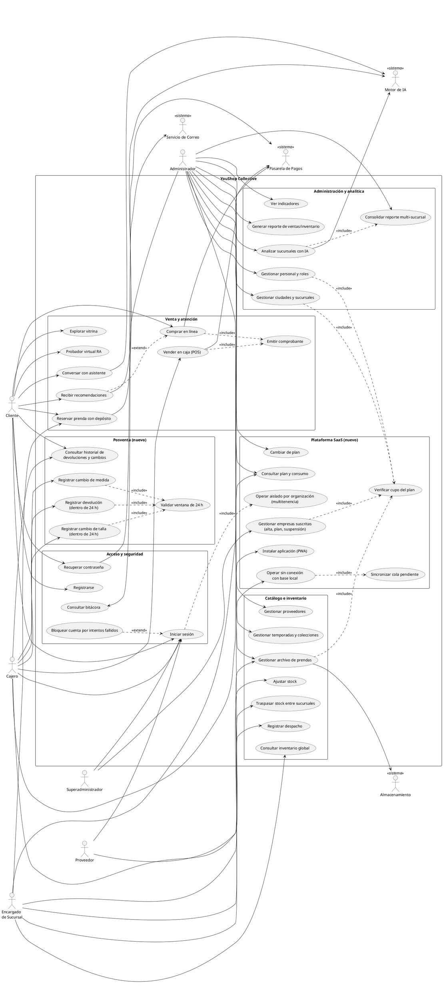

# 1. Modelo de casos de uso

Primer paso de ICONIX. Los actores salen de los roles reales que existen en la
base (`rol`: Administrador, Encargado de Sucursal, Cajero, Proveedor, Cliente)
y los casos de uso de los endpoints efectivamente implementados.

## Actores

| Actor | Origen en el sistema | Alcance |
|-------|----------------------|---------|
| **Cliente** | `rol.codigoRol = 5` | Vitrina, reservas, compra online, su propio historial |
| **Cajero** | `rol.codigoRol = 3` | Caja presencial, devoluciones y cambios |
| **Encargado de Sucursal** | `rol.codigoRol = 2` | Inventario, despachos, reservas de su sucursal |
| **Administrador** | `rol.codigoRol = 1` | Todo lo anterior + personal, planes y reportes |
| **Proveedor** | `rol.codigoRol = 4` | Catálogo asociado a sus productos |
| **Superadministrador** | rol `Superadministrador` (migración 016) | Opera la plataforma SaaS: todas las empresas suscritas |
| *Pasarela de Pagos* (Stripe) | Sistema externo | Cobros con tarjeta |
| *Motor de IA* (Gemini) | Sistema externo | Recomendaciones, chat y análisis multi-sucursal |
| *Almacenamiento* (Supabase) | Sistema externo | Imágenes de producto |
| *Correo* (Brevo) | Sistema externo | Recuperación de contraseña |

## Diagrama general

<!-- Modelo completo: casos de uso existentes + CU26..CU30 nuevos -->

## Casos de uso nuevos — descripción

### CU26 — Operar aislado por organización (multitenencia)

- **Actor principal:** todos los roles (transversal).
- **Precondición:** el usuario pertenece a un tenant activo.
- **Flujo básico:** al iniciar sesión, el backend incorpora el claim `tenant`
  al JWT; toda consulta de catálogo, sucursales, proveedores, temporadas,
  colecciones y personal filtra por ese tenant.
- **Postcondición:** el usuario solo ve y modifica datos de su organización.
- **Excepción:** un recurso de otro tenant responde **404** (no 403): que
  exista no es información que deba cruzar la frontera de la organización.

### CU27 — Consultar plan y cambiar de plan

- **Actor principal:** Administrador (cambio); Encargado y Cajero (consulta).
- **Flujo básico:** se muestran plan vigente, límites y consumo
  (`GET /api/tenant/me`); el administrador puede cambiar de plan
  (`PATCH /api/tenant/plan`).
- **Excepción:** si el consumo actual supera los topes del plan destino, el
  cambio se rechaza con **409** detallando qué recurso lo excede.
- **Regla asociada (CU-CUPO):** crear sucursal, usuario o producto verifica el
  cupo antes de insertar y responde **402** cuando se alcanzó el tope.

### CU28 — Devolución y cambio de talla / medida dentro de 24 h

- **Actor principal:** Cajero (también Encargado y Administrador).
- **Precondición:** existe una venta de ese producto con menos de 24 h.
- **Flujo básico:** se elige un item elegible, se indica el tipo (cambio de
  talla, cambio de medida o devolución), la cantidad y el motivo; el sistema
  reingresa la prenda original al inventario y, si es cambio de talla,
  descuenta la prenda de la talla nueva en la misma transacción.
- **Postcondición:** queda registrado quién, cuándo, qué talla salió y cuál
  entró (consultable por fecha y cliente).
- **Excepciones:** ventana vencida → **409**; cantidad mayor a la disponible
  → **400**; sin stock de la talla nueva → **409** (no se registra nada).

### CU29 — Consolidado multi-sucursal y análisis con IA

- **Actor principal:** Administrador.
- **Flujo básico:** se calcula por SQL el consolidado por sucursal (unidades,
  monto, stock, SKUs críticos); opcionalmente se envía ese consolidado al
  motor de IA, que devuelve diagnóstico por sucursal, transferencias
  sugeridas y alertas.
- **Regla:** la IA solo interpreta métricas ya calculadas; nunca produce
  cifras propias, y las sucursales que no estaban en los datos se descartan.
- **Excepciones:** plan sin IA → **402**; motor no configurado → **503**.

### CU31 — Gestionar empresas suscritas (consola de plataforma)

- **Actor principal:** Superadministrador.
- **Precondición:** el usuario tiene el permiso `plataforma.admin`, que solo
  recibe el rol Superadministrador (ningún Administrador de empresa lo tiene).
- **Flujo básico:** ve todas las empresas con su plan, consumo de cupos,
  administrador y estado, más el ingreso mensual de la plataforma; puede dar
  de alta una empresa con su administrador inicial, cambiarle el plan o
  suspenderla (`/api/platform/*`).
- **Flujos adicionales:** cambiar el nombre visible de una empresa (el
  identificador no cambia); consultar la **bitácora de todas las empresas**
  con paginación y filtros por empresa, texto y fechas; generar, descargar y
  eliminar **respaldos por empresa** (manuales desde la consola, automáticos
  diarios disparados por GitHub Actions, con retención configurable).
- **Postcondición:** una empresa suspendida no puede iniciar sesión hasta que
  se la reactive.
- **Excepciones:** bajar de plan cuando el consumo supera los nuevos topes →
  **409**; suspender la empresa operadora → **409**; un rol sin
  `plataforma.admin` → **403**.

### CU30 — PWA, operación sin conexión y sincronización

- **Actor principal:** Cajero.
- **Flujo básico:** la aplicación se instala en el dispositivo; el catálogo,
  las sucursales y el inventario se replican en la base local (IndexedDB);
  sin conexión, una venta en efectivo se guarda en la cola local y, al volver
  la red, se reenvía automáticamente.
- **Postcondición:** ninguna operación se pierde por falta de conectividad.
- **Excepción:** una operación rechazada definitivamente por el servidor
  queda marcada con el error en la cola, sin reintentos en bucle.
