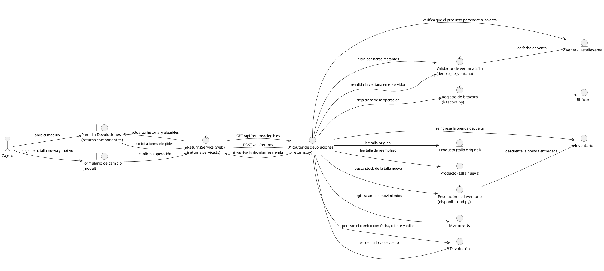
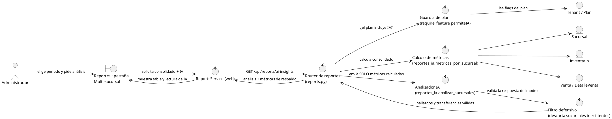
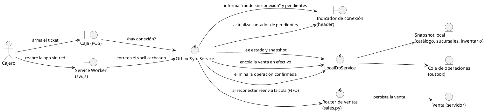
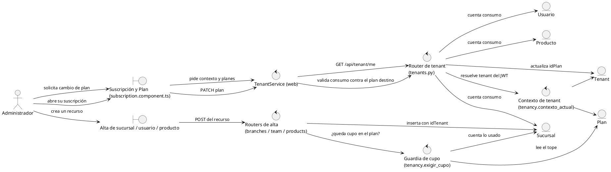

# 2. Análisis de robustez

Segundo paso de ICONIX: por cada caso de uso se identifican los objetos
**frontera** (lo que el actor toca), **control** (la lógica que coordina) y
**entidad** (lo que se persiste). Regla de la notación respetada en todos los
diagramas:

- actor ↔ frontera ✔
- frontera ↔ control ✔
- control ↔ entidad ✔
- control ↔ control ✔
- actor ↔ control ✘ · frontera ↔ frontera ✘ · frontera ↔ entidad ✘ · entidad ↔ entidad ✘

Cada objeto está anotado con el archivo real que lo implementa.

## CU28 — Registrar cambio de talla dentro de 24 h

<!-- CU28 -->

**Caminos alternativos detectados en el análisis** (se convierten en
fragmentos `alt` en el diagrama de secuencia):

1. La ventana de 24 h ya venció → no se toca inventario.
2. La cantidad pedida supera lo devolvible → se rechaza.
3. No hay stock de la talla nueva → no se registra nada (transacción íntegra).

## CU29 — Analizar sucursales con IA

<!-- CU29 -->

## CU30 — Operar sin conexión y sincronizar

<!-- CU30 -->

## CU26 / CU27 — Multitenencia y cupos del plan

<!-- CU26-CU27 -->

