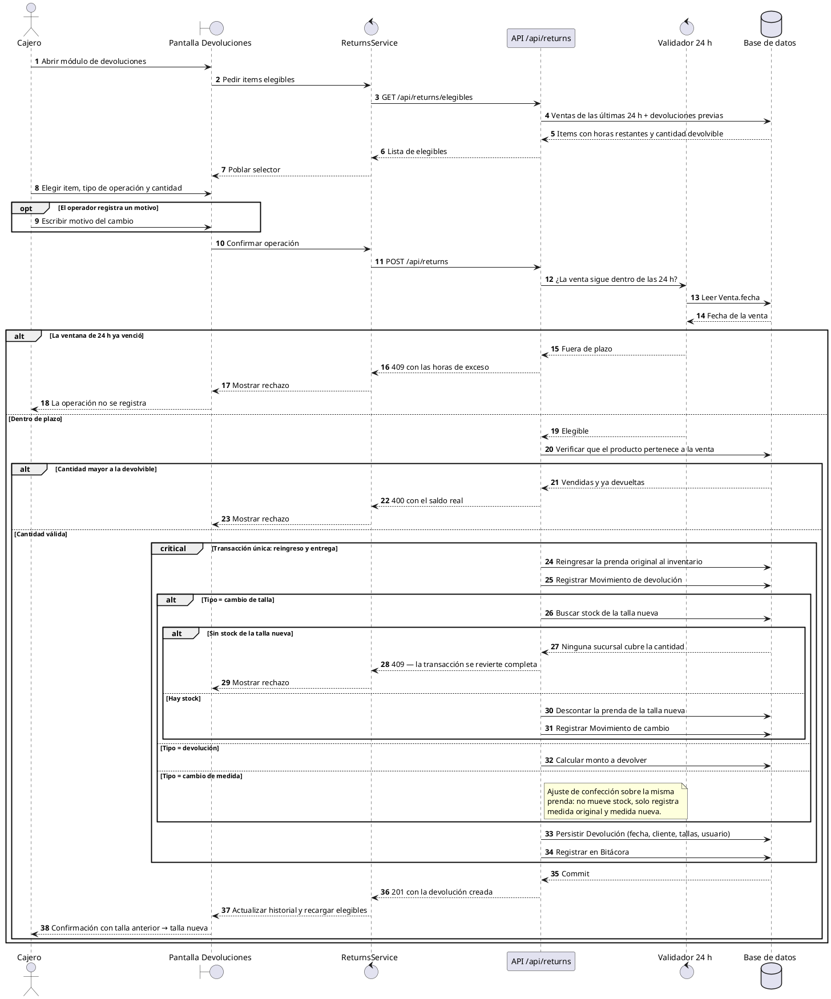
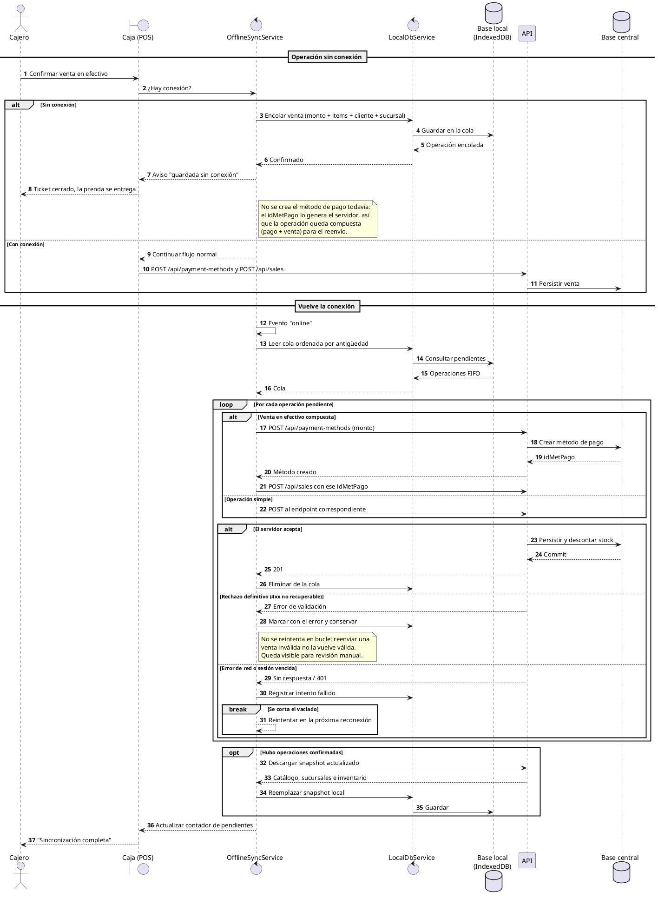
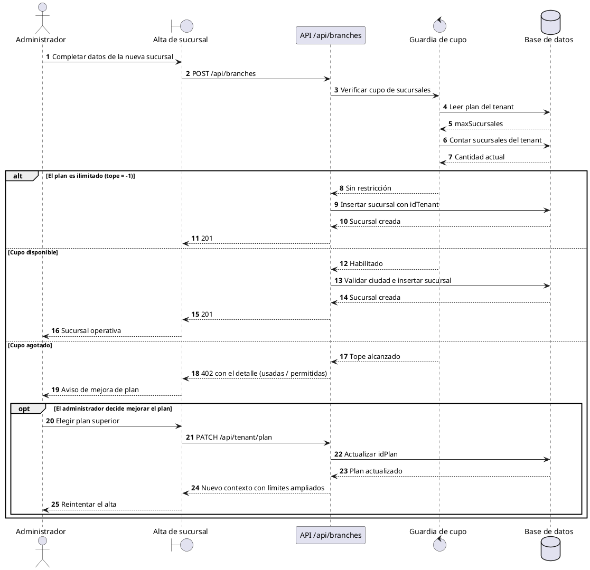

# 3. Diagramas de secuencia

Tercer paso de ICONIX: cada objeto del análisis de robustez se convierte en
una línea de vida, y los caminos alternativos detectados ahí se expresan con
**fragmentos combinados** (`alt`, `opt`, `loop`, `break`, `par`, `critical`,
`ref`).

Los diagramas de la fase anterior (compra online, Stripe, POS, comprobante)
están en [`../../web/diagramSp2Sec.md`](../../web/diagramSp2Sec.md).

---

## CU28 — Cambio de talla dentro de la ventana de 24 h

Fragmentos usados: `alt` (ventana vencida / cantidad inválida / sin stock),
`opt` (motivo), `critical` (la doble corrección de stock es atómica).

<!-- CU28 -->


---

## CU29 — Reporte multi-sucursal con lectura de IA

Fragmentos usados: `alt` (plan sin IA / motor no configurado / respuesta
inválida), `par` (métricas y detalle se calculan en paralelo), `loop`
(validación de cada sugerencia), `ref` (reutiliza el consolidado).

<!-- CU29 -->
```plantuml
@startuml
skinparam shadowing false
autonumber

actor Administrador as Admin
boundary "Reportes · Multi-sucursal" as UI
control "ReportsService" as Front
participant "API /api/reports" as API
control "Guardia de plan" as Plan
control "Servicio de análisis" as Analisis
participant "Motor de IA" as IA
database "Base de datos" as DB

Admin -> UI: Elegir período
UI -> Front: Pedir consolidado
Front -> API: GET /api/reports/branches
API -> DB: Agregar ventas y stock por sucursal del tenant
DB --> API: Métricas por sucursal
API --> Front: Consolidado
Front --> UI: Tabla por sucursal

Admin -> UI: Presionar "Analizar con IA"
UI -> Front: Pedir análisis
Front -> API: GET /api/reports/ai-insights
API -> Plan: ¿El plan incluye IA?
Plan -> DB: Leer flags del plan del tenant
DB --> Plan: permiteIA

alt El plan no incluye IA
  Plan --> API: Denegado
  API --> Front: 402 Payment Required
  Front --> UI: Sugerir mejora de plan
  UI --> Admin: El consolidado sigue disponible
else El plan incluye IA
  Plan --> API: Habilitado

  ref over API, DB
    Mismo cálculo de métricas del consolidado
  end ref

  par Preparación del insumo
    API -> DB: Métricas por sucursal
  and
    API -> DB: Stock por producto y sucursal (muestra acotada)
  end

  alt Sin sucursales cargadas
    DB --> API: Conjunto vacío
    API --> Front: 400 — nada que analizar
  else Hay datos
    API -> Analisis: Analizar (solo métricas ya calculadas)
    Analisis -> IA: Prompt con salida estructurada

    alt El motor no está configurado
      IA --> Analisis: Falta credencial
      Analisis --> API: GeminiNoConfigurado
      API --> Front: 503
      Front --> UI: Avisar que falta configurar el motor
    else El motor responde
      IA --> Analisis: Resumen, hallazgos, transferencias y alertas

      alt La respuesta no es analizable
        Analisis --> API: AnalisisNoDisponible
        API --> Front: 503
      else Respuesta válida
        loop Por cada sugerencia devuelta
          Analisis -> Analisis: ¿La sucursal existe en los datos enviados?
          note right of Analisis
            Defensa contra alucinaciones: se descarta
            toda sugerencia que mencione sucursales
            fuera del conjunto analizado.
          end note
        end
        Analisis --> API: Análisis depurado
        API --> Front: 200 con análisis + métricas de respaldo
        Front --> UI: Mostrar lectura junto a la tabla
        UI --> Admin: Diagnóstico y transferencias sugeridas
      end
    end
  end
end
@enduml
```

---

## CU30 — Venta sin conexión y sincronización posterior

Fragmentos usados: `alt` (con/sin conexión, error definitivo vs. transitorio),
`loop` (vaciado de la cola), `break` (corte por error de red), `opt`
(refresco del snapshot).

<!-- CU30 -->


---

## CU27 — Alta de recurso con verificación de cupo del plan

Fragmentos usados: `alt` (cupo disponible / agotado / plan ilimitado), `opt`
(mejora de plan desde el aviso).

<!-- CU27 -->

