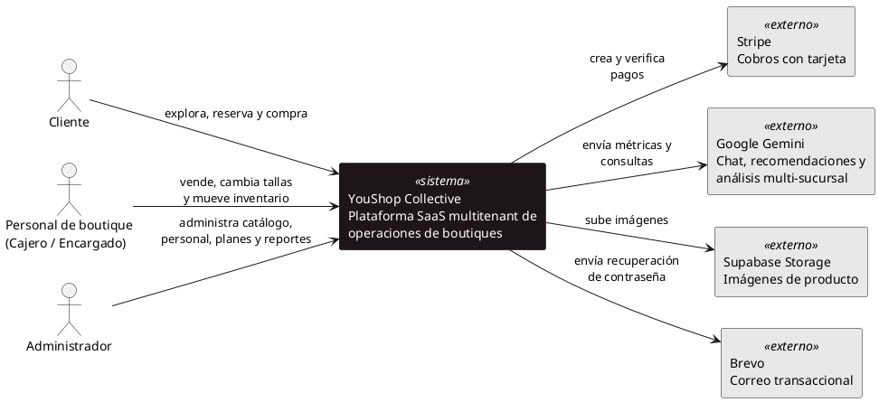
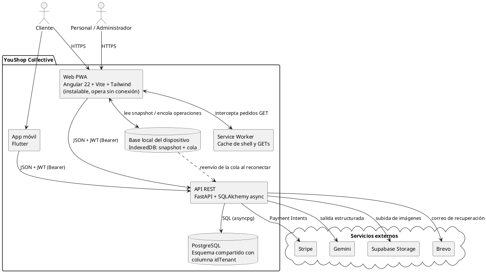
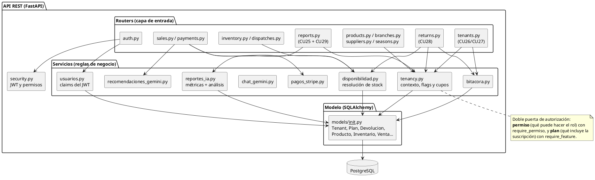
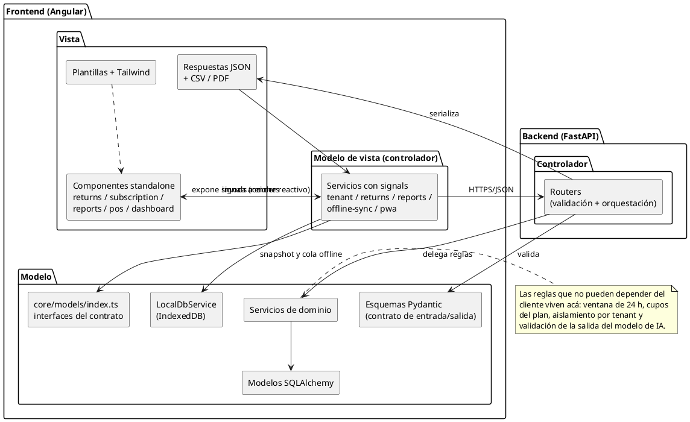
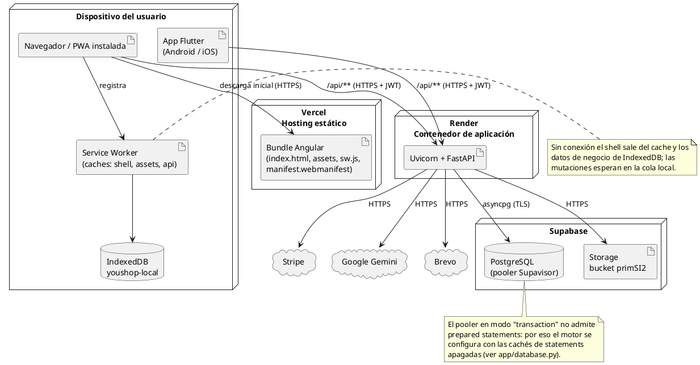
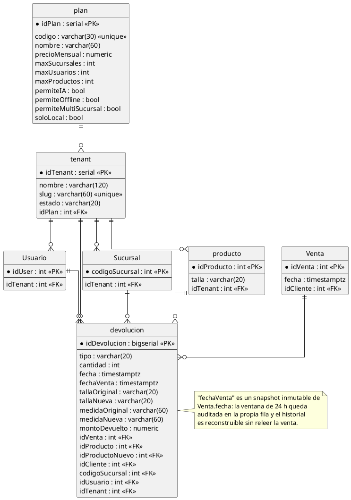

# 4. Arquitectura — vista lógica y vista física

Cuarto paso de ICONIX: dónde vive el código que implementa los casos de uso.
Se documentan las dos vistas pedidas, **lógica** (cómo está organizado) y
**física** (dónde se ejecuta), usando niveles C4 para la descomposición y MVC
para la organización interna.

Los diagramas usan PlantUML estándar (sin librerías externas) para que
rendericen sin conexión.

---

## 4.1 C4 — Nivel 1: Contexto

<!-- C4-L1 -->

---

## 4.2 C4 — Nivel 2: Contenedores

<!-- C4-L2 -->

**Decisión de multitenencia.** De las tres estrategias posibles se eligió
**base de datos compartida + esquema compartido + columna discriminante
(`idTenant`)**:

| Estrategia | Aislamiento | Costo | Aplicable sobre el esquema ya en producción |
|------------|-------------|-------|----------------------------------------------|
| Base por tenant | Máximo | Alto | No (requiere migrar y multiplicar conexiones) |
| Esquema por tenant | Alto | Medio | Parcial (duplica DDL en cada alta) |
| **Columna `idTenant`** | **Lógico, en la consulta** | **Bajo** | **Sí: `DEFAULT 1` deja intactas todas las filas previas** |

Solo las entidades raíz llevan la columna (`Usuario`, `Sucursal`, `producto`,
`Proveedor`, `Temporada`, `Colecciones`); las hojas heredan el tenant por su
clave foránea, para no mantener la misma verdad en dos lugares.

---

## 4.3 C4 — Nivel 3: Componentes de la API

<!-- C4-L3 -->

---

## 4.4 Vista lógica — organización MVC

El backend sigue un MVC por capas y el frontend un MVVM con *signals*, que es
la variante de MVC que impone Angular.

<!-- MVC -->

---

## 4.5 Vista física — despliegue

<!-- DEPLOY -->

---

## 4.6 Modelo de datos de las capacidades nuevas

<!-- ER -->

